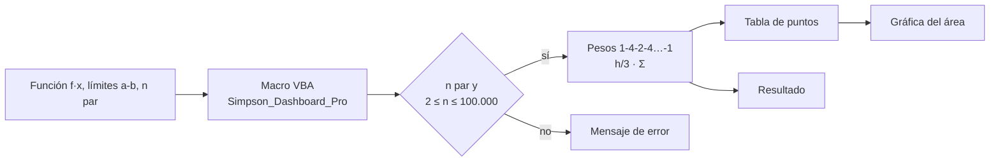

<p align="center"></p>

<h1 align="center">Simpson 1/3</h1>

<p align="center"><b>Numerical integration in Excel with an interactive dashboard and documented VBA code.</b></p>

<p align="center"></p>

<p align="center">
 
</p>

<p align="center"><a href="https://dodysalim.github.io/"><b>🌐 Portfolio</b></a> · <a href="README.md"><b>🇪🇸 Versión en español</b></a></p>

---

## 📌 At a glance

| | |
| --- | --- |
| **🎯 Problem** | Compute definite integrals and visualize the even/odd weights of Simpson's 1/3 rule. |
| **🛠️ Solution** | Excel workbook with VBA macros, input validation and error handling. |
| **📈 Deliverables** | Excel dashboard with point table and method chart. |

## 🏗️ Architecture



## 🚀 How to run

```text
Open Simpson_Pro.xlsm in desktop Excel with macros enabled.
To use the reviewed source, import Simpson_VBA.txt into a VBA module and run Simpson_Dashboard_Pro.
```

## ⚖️ Scope

n must be even, between 2 and 100,000. Accuracy depends on the function and step size.

---

<p align="center">
<b>Dody Dueñas Remache</b> · Data Analyst / Data Scientist · Guayaquil, Ecuador (remote LATAM)<br>
<a href="https://dodysalim.github.io/">Portfolio</a> · <a href="https://github.com/dodysalim">GitHub</a> · <a href="https://www.linkedin.com/in/dody-duenas/">LinkedIn</a> · <a href="mailto:dodydurema67@gmail.com">dodydurema67@gmail.com</a>
</p>
